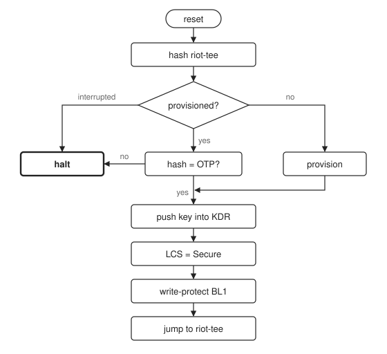
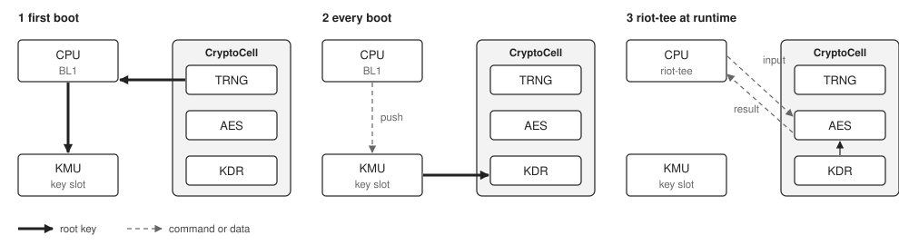
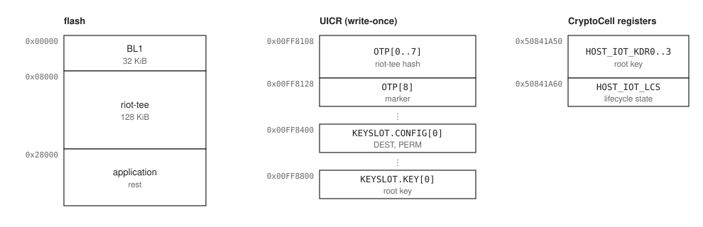

# riot-tee-bl

riot-tee-bl is a minimal first-stage bootloader (BL1) for
[riot-tee](https://github.com/janthies/riot-tee), the TrustZone secure image
for RIOT on the nRF9160. It shows the minimum a TEE needs from the code that
runs before it: a device-unique root key that only the CryptoCell can use, a
check that the secure image is the one the device was provisioned with, and a
bootloader that protects itself before it hands over.

## Boot flow



Every failed check ends in a halt. Nothing is unlocked and nothing is handed over.

## What it guarantees

| | Requirement | How |
|---|---|---|
| R1 | A device-unique root key in the CryptoCell KDR | On the first boot, the TRNG generates the key and BL1 writes it into a KMU key slot that only allows a push. On every boot, the KMU pushes it into the KDR; the CPU never reads it. |
| R2 | riot-tee starts only if unchanged | SHA-256 over the full riot-tee region, compared with the hash stored in UICR OTP on the first boot. |
| R3 | The key and BL1 stay protected after the hand-over | The CryptoCell lifecycle state goes to Secure, so the KDR cannot be changed until the next reset. The SPU removes write access to BL1's flash and locks the configuration. |
| R4 | A clean hand-over | VTOR, stack pointer and reset handler come from riot-tee's vector table. |

## The root key



On the first boot, BL1 copies the TRNG output into a KMU key slot that only
allows a push, and wipes its RAM copy. On every boot, the KMU pushes the key
into the KDR of the CryptoCell without going through the CPU. Setting the
lifecycle state to Secure then fixes the KDR until the next reset. riot-tee
uses the key through the AES engine of the CryptoCell, but cannot read it.

## Memory layout



## Provisioning

Whether a device is provisioned is decided by three states:

| State | Condition | BL1 does |
|---|---|---|
| unprovisioned | marker, hash and key slot are erased | provisions |
| provisioned | marker is set | verifies the hash |
| inconsistent | anything else | halts |

Because the marker is the last word written, a power loss during provisioning
can never leave a device that looks provisioned. A power loss before the first
write simply leads to a fresh provisioning on the next boot.

Provisioning is irreversible. OTP and the key slot can be written only once.
Changing riot-tee afterwards makes BL1 halt. The only way back is erasing the
whole chip, which also erases the key slot; the next boot then creates a new
root key, and everything sealed with the old key is lost:

```sh
nrfjprog --family NRF91 --eraseall
```

## Building

### With RIOT

The RIOT package `pkg/riot-tee-bl` lives on the branch
`hauptprojekt/riot-tee-bl` of [janthies/RIOT](https://github.com/janthies/RIOT).
It is a proof of concept and not part of upstream RIOT. An application selects
it in its Makefile:

```make
USEPKG += riot-tee-bl
```

The package fetches this repository, builds it, moves riot-tee and the
application behind the bootloader, and makes `make flash` write one image with
all three parts. After switching an application between building with and
without the bootloader, run `make clean`.

### Standalone

```sh
git submodule update --init
cmake -B build \
    -DTFM_PATH=/path/to/trusted-firmware-m \
    -DTOOLCHAINPATH=/usr/bin \
    -DCMAKE_BUILD_TYPE=MinSizeRel
cmake --build build
```

`TFM_PATH` is required. BL1 uses the cc3xx driver from TF-M and needs a tree
that contains the CC310 hash fix (`7175d6ef4` on
[janthies/trusted-firmware-m](https://github.com/janthies/trusted-firmware-m)).
Without it, the hash depends on timing and BL1 may halt on an unchanged
riot-tee.

| Option | Default | Meaning |
|---|---|---|
| `BL_FLASH_SIZE` | `0x8000` | flash the bootloader owns |
| `TEE_FLASH_START` | `0x8000` | start of riot-tee |
| `TEE_FLASH_SIZE` | `0x20000` | size of riot-tee, all of it is hashed |
| `BL_TIMING_PIN` | unset | GPIO toggled at start and before the jump, for measuring boot time |

## Checking a board

The CryptoCell has to be enabled before its registers can be read.

```sh
nrfjprog --family NRF91 --memrd 0x00FF8108 --n 36
nrfjprog --family NRF91 --memwr 0x50840500 --val 1
nrfjprog --family NRF91 --memrd 0x50841A50 --n 4
nrfjprog --family NRF91 --memrd 0x50841A60 --n 4
```

The first command shows the hash and the marker. After a successful boot,
`HOST_IOT_KDR0` (`0x50841A50`) reads `1` (key retained) and `HOST_IOT_LCS`
(`0x50841A60`) reads `0x102` (valid, Secure).

## nRF9160 errata

Two errata shaped the code:

- **Anomaly 7.** Back-to-back reads of UICR and main flash can return wrong
  data. The erratum names a UICR read followed by a flash read; on the board,
  the opposite order failed as well. Every UICR access is therefore enclosed in
  DSBs (`uicr_read()`, `uicr_write()`).
- **Anomaly 21.** Disabling the instruction cache makes the CPU skip the next
  instruction. BL1 does not touch the cache.

## Limitations

- No signatures, no updates and no rollback protection. The reference is the
  riot-tee image present on the first boot (trust on first use).
- The debug port is not locked (`APPROTECT` is not set), so a debugger can still
  read and change the device.
- nRF9160 only. The flow is generic, but KMU, CryptoCell-310, UICR OTP and SPU
  are specific to this chip.
