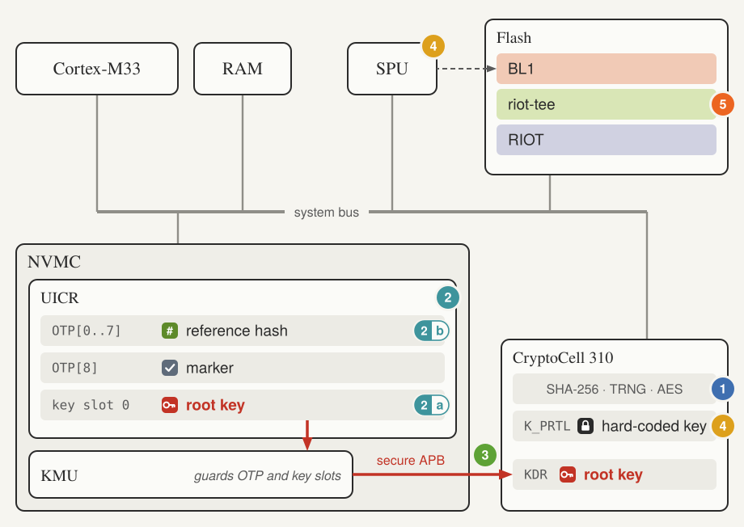
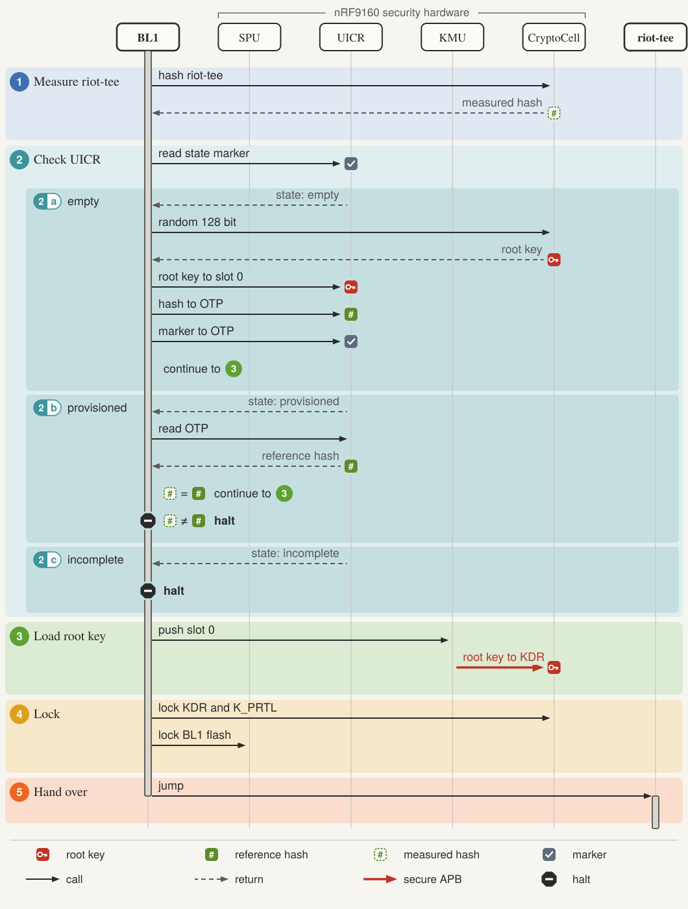
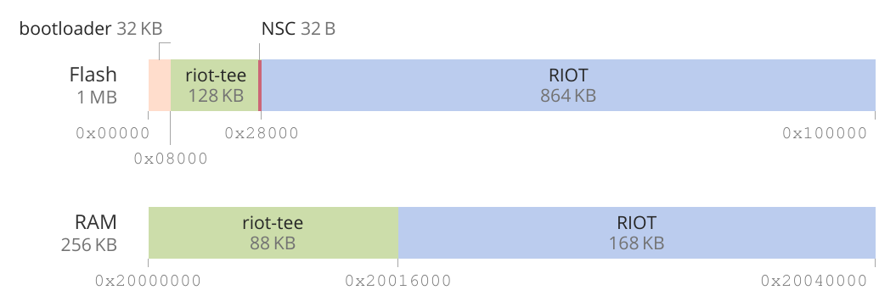

# riot-tee-bl

riot-tee-bl is a minimal first-stage bootloader (BL1) for [riot-tee](https://github.com/janthies/riot-tee), the secure firmware that gives RIOT a trusted execution environment on the nRF9160. I wrote it as a prototype for my Hauptprojekt at HAW Hamburg. It has only run on one nRF9160 DK and has known gaps (see the end of this file), so please do not use it to protect real devices.

## Why riot-tee needs a bootloader

Without a bootloader, riot-tee runs directly after reset, and three things are missing. First, the device has no key of its own. When the CryptoCell's key register (KDR) is empty, riot-tee falls back to a key from its source code, and on the board this fallback even ends up as the all-zero key, because riot-tee writes the key after it has switched the CryptoCell off. Second, nothing checks the riot-tee image before it runs. Third, nothing protects the image or the key from software that runs later. The Hauptprojekt derives four requirements from these gaps.

| | Requirement |
|---|---|
| R1 | Provision and persistently store a device-unique root key. |
| R2 | Verify the integrity of riot-tee before it runs. |
| R3 | Protect BL1 and the key material from software that runs later. |
| R4 | Transfer execution to riot-tee. |

BL1 meets them with a single C file of about 400 lines. Built with `MinSizeRel`, it needs 12,376 bytes of flash and 2,404 bytes of RAM, which fits into the first 32 KB SPU region of the flash.

## How it works



The figure shows the parts of the nRF9160 that BL1 uses. The numbers refer to the steps of the boot sequence below.



On every boot, BL1 first hashes the whole riot-tee region, `0x8000` to `0x27FFF`, with the SHA-256 engine of the CryptoCell. Only then does it read the UICR to find out whether the device has been provisioned. Hashing first means that steps 2a and 2b work on the same measurement. Three states are possible:

| State | Condition | BL1 does |
|---|---|---|
| empty | marker, hash and key slot header are erased | provisions the device |
| provisioned | the marker is set | compares the hash, halts on a mismatch |
| incomplete | anything else | halts |

Provisioning happens once, on the first boot. The TRNG of the CryptoCell produces a 128-bit root key, and BL1 writes it into key slot 0 in the UICR, which the KMU guards. The slot's destination is the KDR, and its permissions allow only a push, neither reading nor writing. BL1 then wipes its copy of the key from RAM, writes the hash into the UICR OTP words 0 to 7, and writes the marker `0x52544231` ("RTB1") into OTP word 8 as the very last step. Because the slot header is written first and the marker last, a power loss during provisioning always leaves the incomplete state behind. BL1 then halts instead of provisioning over a half-written slot, and only a full chip erase brings the device back.

On every boot that gets past the hash, the KMU pushes the root key from the slot into the KDR over a dedicated bus, so the key never passes through the CPU. BL1 then sets the lifecycle state of the CryptoCell to Secure. In this state the KDR ignores every further write until the next reset, and the state itself can be set only once per reset. Without this step, software that runs after BL1 could switch the CryptoCell to DebugEnable and load a key of its own choosing. BL1 also locks K<sub>PRTL</sub>, a fixed key that is the same on all chips of the same part.

Before it hands over, BL1 removes the write permission from its own SPU flash region and locks the region's configuration until the next reset. Read and execute stay allowed, because BL1 still runs from this region until the jump. Finally it sets `VTOR` to riot-tee's vector table and loads the stack pointer and branches to riot-tee's reset handler in one assembler block. Any failed check, including a TRNG error and a key slot write that the KMU blocks, ends in a halt loop.



BL1 occupies the first 32 KB of flash. riot-tee follows at `0x8000` with 128 KB, the last 32 bytes of which hold the non-secure callable veneers, and RIOT starts at `0x28000`. riot-tee starts RIOT without checking it, so the chain of trust that BL1 establishes ends with riot-tee.

Two errata of the nRF9160 shaped the code. Anomaly 7 makes back-to-back accesses to UICR and main flash unreliable. On the board, a literal-pool load from main flash directly before a UICR read produced a wrong base address, and BL1 misjudged the provisioning state depending on the code layout. Every UICR access therefore sits between two `DSB` instructions (`uicr_read()`, `uicr_write()`). Anomaly 21 makes the CPU skip the instruction that follows disabling the instruction cache, which once skipped the initialisation of the hash engine. BL1 leaves the cache alone.

## Building

### With RIOT

The RIOT package `pkg/riot-tee-bl` lives on the branch `hauptprojekt/riot-tee-bl` of [janthies/RIOT](https://github.com/janthies/RIOT) and, like this repository, is not part of upstream RIOT. An application selects it in its Makefile:

```make
USEPKG += riot-tee-bl
```

The package fetches and builds this repository, moves riot-tee and the application behind the bootloader, and makes `make flash` write one image with all three parts. Run `make clean` after switching an application between building with and without the bootloader.

### Standalone

```sh
git submodule update --init
cmake -B build \
    -DTFM_PATH=/path/to/trusted-firmware-m \
    -DTOOLCHAINPATH=/usr/bin \
    -DCMAKE_BUILD_TYPE=MinSizeRel
cmake --build build
```

BL1 uses the cc3xx driver from TF-M, so `TFM_PATH` is required. The tree must contain the fix that makes the driver wait for the hash engine (`7175d6ef4` on [janthies/trusted-firmware-m](https://github.com/janthies/trusted-firmware-m)). Without it, the first words of the hash depend on timing, and BL1 may halt on an unchanged riot-tee.

| Option | Default | Meaning |
|---|---|---|
| `BL_FLASH_SIZE` | `0x8000` | flash that the bootloader owns |
| `TEE_FLASH_START` | `0x8000` | start of riot-tee |
| `TEE_FLASH_SIZE` | `0x20000` | size of riot-tee; the whole region is hashed |
| `BL_TIMING_PIN` | unset | GPIO that BL1 toggles at its start and before the jump, for measuring the boot time |

## Checking a board

The CryptoCell has to be enabled before its registers can be read.

```sh
nrfjprog --family NRF91 --memrd 0x00FF8108 --n 36
nrfjprog --family NRF91 --memwr 0x50840500 --val 1
nrfjprog --family NRF91 --memrd 0x50841A50 --n 4
nrfjprog --family NRF91 --memrd 0x50841A60 --n 4
```

The first command shows the stored hash and the marker. After a successful boot, `HOST_IOT_KDR0` (`0x50841A50`) reads `1`, which means that a key is loaded, and `HOST_IOT_LCS` (`0x50841A60`) reads `0x102`, which means Secure and valid.

## Limitations

BL1 trusts whatever riot-tee image it finds on the first boot. If someone replaces riot-tee between flashing and the first boot, BL1 records the replaced image as the reference. For the same reason, riot-tee cannot be updated: any change makes BL1 halt, and the only way back is a full chip erase, which also erases the root key and makes everything sealed with it unreadable. A design with updates would need a second stage that verifies signed images.

The debug port stays open, because `UICR.SECUREAPPROTECT` and `UICR.ERASEPROTECT` are not set. Anyone with a debugger can therefore read and rewrite the device, including BL1. BL1 does not defend against physical attacks such as fault injection or side-channel analysis either, and the chain of trust ends with riot-tee.

The tests ran on one board. They show that every provisioning creates a new key, but not how good the entropy of the TRNG is. BL1 runs only on the nRF9160, because the KMU, the CryptoCell-310, the UICR OTP and the SPU are specific to this chip.
